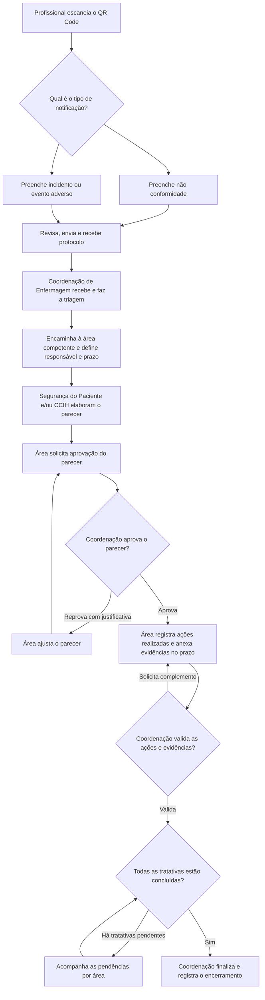

# UHP Notifica

Sistema interno de notificações de não conformidades, incidentes e eventos adversos. O profissional lê um único QR Code, escolhe o formulário e recebe um protocolo. A Coordenação de Enfermagem recebe a notificação, encaminha a tratativa, decide sobre os pareceres e encerra o caso.

## Fluxograma da notificação

Quando as duas áreas forem necessárias, cada uma terá seu próprio responsável, parecer, prazo, ações e evidências. A aprovação de um parecer libera a etapa de ações daquela área. A Coordenação pode visualizar as duas tratativas na mesma notificação.

## Perfis e permissões

| Perfil | Acesso e atribuições |
| --- | --- |
| Profissional notificante | Abre o formulário pelo QR Code, registra a ocorrência e recebe o protocolo do envio. |
| Coordenação de Enfermagem | Recebe todas as notificações da unidade, faz a triagem, encaminha para Segurança do Paciente e/ou CCIH, define responsáveis e prazos, aprova ou reprova pareceres, valida as ações e evidências e finaliza a notificação. |
| Segurança do Paciente | Consulta as tratativas encaminhadas à sua área, elabora e revisa pareceres, solicita aprovação e registra ações realizadas com evidências dentro dos prazos. |
| CCIH | Consulta as tratativas encaminhadas à sua área, elabora e revisa pareceres, solicita aprovação e registra ações realizadas com evidências dentro dos prazos. |

## Regras para a implementação

1. **Entrada da notificação.** Reutilizar os campos e as opções dos protótipos. O formulário de incidente ou evento adverso deve manter **Nenhum (incidente sem dano)**. O servidor emite o protocolo após confirmar o registro. A tela do QR Code oferece apenas o fluxo de registro.
2. **Triagem e encaminhamento.** Uma notificação começa como **Recebida**, passa para **Em tratativa** quando a Coordenação encaminha para uma ou ambas as áreas e termina como **Finalizada**. A Coordenação escolhe o responsável e registra os prazos do parecer e das ações por tratativa. Prazo vencido gera um indicador de atraso e mantém a tratativa aberta.
3. **Parecer e aprovação.** A área pode salvar rascunho e enviar para aprovação. A Coordenação registra aprovação ou reprovação. A reprovação exige justificativa e devolve a tratativa para revisão. Cada nova submissão cria uma versão do parecer e preserva as decisões anteriores.
4. **Ações e evidências.** Com o parecer aprovado, a área descreve cada ação, informa a data de execução e anexa as evidências. A Coordenação pode validar a tratativa ou pedir complemento com justificativa. Parecer aprovado, ações registradas e validação das evidências são requisitos para considerar a tratativa concluída.
5. **Encerramento.** Apenas a Coordenação pode finalizar, após validar todas as tratativas atribuídas. O sistema registra a data, a pessoa responsável e a conclusão do caso.
6. **Controle de acesso e histórico.** O servidor verifica perfil, unidade e vínculo com a tratativa em cada operação. Evidências ficam em armazenamento privado, com acesso vinculado à permissão sobre a tratativa. O histórico registra autor, data e decisão em cada encaminhamento, envio, aprovação, reprovação, validação e encerramento.
7. **Testes e dados.** Use somente dados fictícios no código, nos testes, em imagens e em discussões deste repositório público. Credenciais, notificações reais e evidências ficam no ambiente da unidade.

A exigência de dois prazos por tratativa, a validação das evidências pela Coordenação e o alcance do acesso por unidade são propostas para a primeira implementação. A definição dos prazos padrão e do acesso institucional à página do QR Code fica para validação com a unidade.

## Divisão do trabalho entre as IAs

| Ordem | Responsável | Atualizações previstas no repositório | Dependência |
| --- | --- | --- | --- |
| 1 | Codex | Adicionar o fluxograma, as regras e os protótipos de referência. | Fluxo informado pelo usuário. |
| 2 | Codex | Implementar autenticação do painel, perfis, permissões, banco de dados, serviços de notificação e tratativa, histórico e armazenamento privado de evidências. Documentar o contrato de integração com exemplos fictícios. | Fluxo e regras deste README. |
| 3 | Outra IA | Adaptar os dois HTMLs para o sistema. Implementar entrada por QR Code, formulário com confirmação de protocolo, fila de triagem da Coordenação, fila por área e telas de parecer, prazos, ações e evidências. Desenvolver com dados simulados enquanto a API estiver em construção. | Regras deste README e contrato publicado pelo Codex antes da integração. |
| 4 | Codex e outra IA | Integrar o frontend com a API e verificar o fluxo completo. A outra IA corrige as telas e o Codex corrige o backend, as permissões e as regras de transição. | Pull requests de frontend e backend prontos para integração. |

O Codex deve publicar o contrato antes de integrar as telas. O contrato deve cobrir criação de notificação e retorno do protocolo, filas por perfil, encaminhamento, parecer e aprovação, ações e evidências, histórico e encerramento. Para cada operação, documentar campos, permissões, estados e respostas de erro. Usar branches separadas para backend e frontend e registrar no pull request as operações alteradas, os cenários testados e as dependências pendentes.

### Tarefa inicial para a outra IA

> Leia este README e os arquivos em `prototipos/`. Trabalhe em uma branch de frontend. Reaproveite os campos e as opções dos dois formulários. Monte a tela de entrada do QR Code e as telas da Coordenação de Enfermagem, Segurança do Paciente e CCIH, com dados fictícios. Inclua triagem, prazo, parecer, solicitação de aprovação, retorno para correção, ações e evidências. Isole o acesso a dados para conectar as telas ao contrato que o Codex vai publicar. Abra um pull request descrevendo o que implementou e o que depende do backend.

## Critérios para considerar o fluxo pronto

- Enviar pelo celular uma notificação de cada tipo, receber um protocolo por envio e visualizar os registros na fila da Coordenação em outro aparelho.
- Encaminhar um mesmo caso às duas áreas, mantendo responsáveis, prazos, pareceres e evidências por tratativa.
- Reprovar um parecer com justificativa, reenviar a versão ajustada e aprová-la com o histórico das duas decisões.
- Registrar uma ação, anexar evidência, visualizar atraso e atender uma solicitação de complemento.
- Bloquear o encerramento com tratativa pendente e permitir a finalização pela Coordenação quando todas forem validadas.
- Confirmar que uma conta de área não consegue consultar ou alterar casos sem vínculo, inclusive via chamadas diretas à API, nem acessar anexos de outras tratativas.

## Protótipos de referência

| Arquivo | Uso |
| --- | --- |
| [Portal_Notificacoes_V1.html](prototipos/Portal_Notificacoes_V1.html) | Escolha do tipo, preenchimento, revisão e registro de teste. |
| [Painel_Gerente_Notificacoes.html](prototipos/Painel_Gerente_Notificacoes.html) | Consulta, filtros e acompanhamento local de registros de teste. |

Os protótipos atuais usam armazenamento local do navegador e importação de arquivos de teste. A implementação prevista usa autenticação, armazenamento compartilhado e evidências privadas.

## Registro de implementação para as IAs

| Etapa | Alterações registradas | Onde consultar |
| --- | --- | --- |
| Backend inicial | Login, permissões por unidade e tratativa, recebimento com protocolo, filas, responsáveis, prazos, versões do parecer, aprovação, ações, evidências privadas, histórico e encerramento. | [PR nº 1](https://github.com/faturamento1023/uhp-notifica-/pull/1) · [Contrato da API](https://github.com/faturamento1023/uhp-notifica-/blob/codex/backend-notificacoes/docs/API.md) |
| Foto da ocorrência | Os dois formulários aceitam uma foto opcional JPEG ou PNG de até 2 MB (2 MiB). A pessoa pode conferir a foto na revisão, voltar para trocá-la ou removê-la. O painel exibe a imagem no detalhe. O arquivo de teste JSON inclui a foto e a importação continua aceitando registros anteriores sem foto. | [Portal de teste](prototipos/Portal_Notificacoes_V1.html) · [Painel de teste](prototipos/Painel_Gerente_Notificacoes.html) |

### Integração da foto no frontend

- Incluir o campo **Foto da ocorrência (opcional)** tanto em não conformidade quanto em incidente ou evento adverso. Manter a prévia, a remoção e o envio sem foto.
- Enviar a imagem junto com o registro no `POST /api/v1/notifications`, no campo `photo: { name, mime, contentBase64 }`. O Base64 deve vir sem o prefixo da URL de dados. O protocolo e a foto são gravados na mesma operação. Se a foto mudar após uma tentativa confirmada pelo servidor, o mesmo identificador de envio não pode ser reutilizado para outro conteúdo.
- No painel integrado, ler `photo` no detalhe e carregar a imagem por `GET /api/v1/notifications/{id}/photo` com a sessão atual. A Coordenação da unidade e os responsáveis pelas tratativas atribuídas podem consultar a foto. O anexo inicial da ocorrência é independente das evidências das ações.
- O Codex atualizou os protótipos, a API, o banco, o contrato e os testes de acesso à foto. A outra IA deve reaproveitar o comportamento na branch de frontend. O protótipo HTML segue destinado a dados fictícios e usa importação ou armazenamento local. A publicação institucional depende da integração com o backend do PR nº 1.
