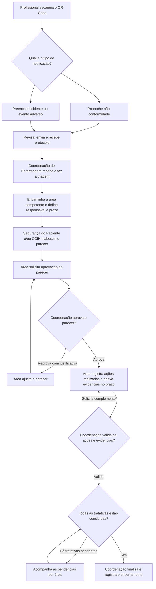

# UHP Notifica

Sistema interno de notificações de não conformidades, incidentes e eventos adversos. O profissional lê um único QR Code, escolhe o formulário e recebe um protocolo. A Coordenação de Enfermagem recebe a notificação, encaminha a tratativa, decide sobre os pareceres e encerra o caso.

## Fluxograma da notificação



Quando as duas áreas forem necessárias, cada uma terá seu próprio responsável, parecer, prazo, ações e evidências. A aprovação de um parecer libera a etapa de ações daquela área. A Coordenação pode visualizar as duas tratativas na mesma notificação.

## Perfis e permissões

| Perfil | Acesso e atribuições |
| --- | --- |
| Profissional notificante | Abre o formulário pelo QR Code, registra a ocorrência e recebe o protocolo do envio. |
| Coordenação de Enfermagem | Recebe todas as notificações da unidade, faz a triagem, encaminha para Segurança do Paciente e/ou CCIH, define responsáveis e prazos, aprova ou reprova pareceres, valida as ações e evidências e finaliza a notificação. |
| Segurança do Paciente | Consulta as tratativas encaminhadas à sua área, elabora e revisa pareceres, solicita aprovação e registra ações realizadas com evidências dentro dos prazos. |
| CCIH | Consulta as tratativas encaminhadas à sua área, elabora e revisa pareceres, solicita aprovação e registra ações realizadas com evidências dentro dos prazos. |

## Regras para a implementação

1. **Entrada da notificação.** Reutilizar os campos e as opções dos protótipos. O formulário de incidente ou evento adverso deve manter **Nenhum (incidente sem dano)**. O servidor emite o protocolo após confirmar o registro. A tela do QR Code oferece apenas o fluxo de registro.
2. **Triagem e encaminhamento.** Uma notificação começa como **Recebida**, passa para **Em tratativa** quando a Coordenação encaminha para uma ou ambas as áreas e termina como **Finalizada**. A Coordenação escolhe o responsável e registra os prazos do parecer e das ações por tratativa. Prazo vencido gera um indicador de atraso e mantém a tratativa aberta.
3. **Parecer e aprovação.** A área pode salvar rascunho e enviar para aprovação. A Coordenação registra aprovação ou reprovação. A reprovação exige justificativa e devolve a tratativa para revisão. Cada nova submissão cria uma versão do parecer e preserva as decisões anteriores.
4. **Ações e evidências.** Com o parecer aprovado, a área descreve cada ação, informa a data de execução e anexa as evidências. A Coordenação pode validar a tratativa ou pedir complemento com justificativa. Parecer aprovado, ações registradas e validação das evidências são requisitos para considerar a tratativa concluída.
5. **Encerramento.** Apenas a Coordenação pode finalizar, após validar todas as tratativas atribuídas. O sistema registra a data, a pessoa responsável e a conclusão do caso.
6. **Controle de acesso e histórico.** O servidor verifica perfil, unidade e vínculo com a tratativa em cada operação. Evidências ficam em armazenamento privado, com acesso vinculado à permissão sobre a tratativa. O histórico registra autor, data e decisão em cada encaminhamento, envio, aprovação, reprovação, validação e encerramento.
7. **Testes e dados.** Use somente dados fictícios no código, nos testes, em imagens e em discussões deste repositório público. Credenciais, notificações reais e evidências ficam no ambiente da unidade.

A exigência de dois prazos por tratativa, a validação das evidências pela Coordenação e o alcance do acesso por unidade são propostas para a primeira implementação. A definição dos prazos padrão e do acesso institucional à página do QR Code fica para validação com a unidade.

## Divisão do trabalho entre as IAs

| Responsável | Já entregue | Próxima entrega |
| --- | --- | --- |
| **Codex — backend e verificação** | Fluxograma, protótipos de referência, contrato da API e backend no PR nº 1. A API cobre login, permissões, protocolo, foto da ocorrência, filas, prazos, pareceres, ações, evidências e encerramento. | Revisar o PR do frontend, testar o fluxo de ponta a ponta com dados fictícios e corrigir o backend ou o contrato se a integração apontar problemas. Registrar cada mudança neste README. |
| **Outra IA — frontend e integração das telas** | Os dois HTMLs em `prototipos/` servem como referência dos campos e do comportamento. | Construir as telas para celular e computador, conectar à API publicada, testar os estados de tela e entregar um PR de frontend. |

### Entrega da outra IA

1. **Entrada pelo QR Code.** Adaptar o portal para os dois formulários existentes, com foto opcional, prévia, troca ou remoção da imagem, revisão dos dados e confirmação do protocolo devolvido pela API.
2. **Painel da Coordenação de Enfermagem.** Criar login, fila de notificações, detalhe com foto e histórico, encaminhamento para uma ou ambas as áreas, definição de responsável e prazos, aprovação ou devolução de parecer com justificativa, validação das ações e encerramento.
3. **Painel de Segurança do Paciente e CCIH.** Mostrar as tratativas atribuídas à conta e seus prazos. Permitir salvar rascunho, solicitar aprovação, revisar parecer devolvido, registrar ações, anexar evidências e responder a pedidos de complemento.
4. **Integração.** Usar o [contrato da API](https://github.com/faturamento1023/uhp-notifica-/blob/codex/backend-notificacoes/docs/API.md). A versão integrada deve usar a API para envio, consulta e atualização. Tratar carregamento, erro e ausência de registros. Usar dados fictícios nos testes.
5. **Entrega no GitHub.** Trabalhar em uma branch própria e abrir um PR com as telas entregues, rotas integradas, testes executados e pendências. Registrar a entrega neste README. Se houver uma lacuna no contrato, descrever a operação e o comportamento esperado no PR para o Codex ajustar a API.

### Ordem de integração

A outra IA já pode começar pelas telas e usar o [backend do PR nº 1](https://github.com/faturamento1023/uhp-notifica-/pull/1) para testar a integração. Quando o PR do frontend estiver disponível, o Codex verifica o percurso do QR Code ao encerramento, incluindo o acesso à foto e às evidências por perfil. A publicação institucional fica para depois dessa verificação.

### Instruções para repassar à outra IA

> Você vai implementar o frontend do UHP Notifica. Leia o fluxo deste README, confira os HTMLs em `prototipos/` e use o contrato da API do PR nº 1. Crie uma branch de frontend a partir da `main` e use o backend do PR nº 1 em um ambiente de teste para conectar as telas.
>
> Entregue primeiro a entrada pelo QR Code. Reaproveite os campos dos formulários de não conformidade e de incidente ou evento adverso. Inclua foto opcional com prévia e remoção, revisão do preenchimento e confirmação do protocolo retornado pelo servidor.
>
> Depois, implemente o login e os painéis. A Coordenação de Enfermagem recebe, encaminha, define prazos, aprova ou devolve pareceres, valida ações e encerra a notificação. Segurança do Paciente e CCIH veem as tratativas atribuídas à conta, elaboram pareceres e registram ações com evidências. Mostre a foto da ocorrência no detalhe para as contas com acesso ao caso.
>
> Abra um PR para a `main` e indique a dependência do PR nº 1. Liste as telas entregues, as rotas integradas, os testes com dados fictícios e qualquer lacuna na API. Registre a entrega neste README. O Codex assume a revisão ponta a ponta e os ajustes no backend a partir desse PR.

## Critérios para considerar o fluxo pronto

- Enviar pelo celular uma notificação de cada tipo, receber um protocolo por envio e visualizar os registros na fila da Coordenação em outro aparelho.
- Encaminhar um mesmo caso às duas áreas, mantendo responsáveis, prazos, pareceres e evidências por tratativa.
- Reprovar um parecer com justificativa, reenviar a versão ajustada e aprová-la com o histórico das duas decisões.
- Registrar uma ação, anexar evidência, visualizar atraso e atender uma solicitação de complemento.
- Bloquear o encerramento com tratativa pendente e permitir a finalização pela Coordenação quando todas forem validadas.
- Confirmar que uma conta de área não consegue consultar ou alterar casos sem vínculo, inclusive via chamadas diretas à API, nem acessar anexos de outras tratativas.

## Protótipos de referência

| Arquivo | Uso |
| --- | --- |
| [Portal_Notificacoes_V1.html](prototipos/Portal_Notificacoes_V1.html) | Escolha do tipo, preenchimento, revisão e registro de teste. |
| [Painel_Gerente_Notificacoes.html](prototipos/Painel_Gerente_Notificacoes.html) | Consulta, filtros e acompanhamento local de registros de teste. |

Os protótipos atuais usam armazenamento local do navegador e importação de arquivos de teste. A implementação prevista usa autenticação, armazenamento compartilhado e evidências privadas.

## Registro de implementação para as IAs

| Etapa | Alterações registradas | Onde consultar |
| --- | --- | --- |
| Backend inicial | Login, permissões por unidade e tratativa, recebimento com protocolo, filas, responsáveis, prazos, versões do parecer, aprovação, ações, evidências privadas, histórico e encerramento. | [PR nº 1](https://github.com/faturamento1023/uhp-notifica-/pull/1) · [Contrato da API](https://github.com/faturamento1023/uhp-notifica-/blob/codex/backend-notificacoes/docs/API.md) |
| Migração para Supabase | O backend do PR nº 1 passou a usar PostgreSQL no Supabase. A migração cria o esquema privado `uhp_notifica`, com RLS e sem acesso direto pelos papéis da Data API. Fotos e evidências permanecem acessíveis pela API, conforme o vínculo com o caso. Os quatro testes passaram em PostgreSQL local. Migração aplicada no projeto hospedado. A API está publicada e conectada ao banco. Falta homologar com as telas integradas. | [Instalação no Supabase](https://github.com/faturamento1023/uhp-notifica-/blob/codex/backend-notificacoes/docs/SUPABASE.md) · [Migração](https://github.com/faturamento1023/uhp-notifica-/blob/codex/backend-notificacoes/supabase/migrations/20261113120820_uhp_notifica.sql) |
| Foto da ocorrência | Os dois formulários aceitam uma foto opcional JPEG ou PNG de até 2 MB (2 MiB). A pessoa pode conferir a foto na revisão, voltar para trocá-la ou removê-la. O painel exibe a imagem no detalhe. O arquivo de teste JSON inclui a foto e a importação continua aceitando registros anteriores sem foto. | [Portal de teste](prototipos/Portal_Notificacoes_V1.html) · [Painel de teste](prototipos/Painel_Gerente_Notificacoes.html) |

O frontend continua usando as rotas `/api/v1` e o cookie de sessão. A URL de conexão do Supabase é configurada no servidor. A outra IA pode continuar seguindo o contrato publicado.

### Supabase hospedado

O projeto **UHP Notifica** foi criado na organização `mediflow_tec`, na região de São Paulo (`sa-east-1`). A migração `uhp_notifica` está aplicada no ambiente hospedado e consta no histórico remoto sob a versão `20261113120820`. O arquivo SQL no PR nº 1 usa a mesma versão do histórico remoto. O próximo deploy deve reconhecer a migração como já aplicada.

A verificação no banco confirmou RLS nas 11 tabelas, ausência de acesso pelos papéis da Data API e gravação de notificação, foto e histórico pelo papel da aplicação. O teste foi revertido e o esquema segue sem registros de teste. O diagnóstico de segurança retornou zero apontamentos.

A API de homologação está hospedada no Supabase. O provisionamento das contas da unidade e a integração do frontend antecedem a liberação para a equipe. As telas continuam chamando `/api/v1` conforme o contrato. [Projeto no Supabase](https://supabase.com/dashboard/project/mtthtojrcpbdeocztrpx) · [Instalação no Supabase](https://github.com/faturamento1023/uhp-notifica-/blob/codex/backend-notificacoes/docs/SUPABASE.md)

### Homologação no Netlify

O [endereço principal](https://uhp-notifica.netlify.app) já publica a página de homologação a partir da `main`. A página inicial e `/api/v1/health` retornaram `200` nesse endereço. A verificação da API mostrou conexão com o banco e que a primeira unidade ainda precisa ser provisionada.

O Netlify publica a interface a partir do GitHub e encaminha `/api/v1/*` para a função `uhp-api` no Supabase. A função usa a conexão fornecida pelo Supabase e executa as consultas com o papel `uhp_notifica_app`. A variável `UHP_DATABASE_URL` deixou de ser necessária no Netlify. O [Deploy Preview nº 1](https://deploy-preview-1--uhp-notifica.netlify.app) está publicado e a [rota de verificação](https://deploy-preview-1--uhp-notifica.netlify.app/api/v1/health) retornou `200`. A verificação sem sessão retornou `401`. [Guia de homologação](https://github.com/faturamento1023/uhp-notifica-/blob/codex/backend-notificacoes/docs/NETLIFY.md)

O teste HTTP de ponta a ponta passou pelo endereço do Netlify com as três contas fictícias. Foram verificados o envio com foto, a repetição com o mesmo protocolo, os pareceres de Segurança do Paciente e CCIH, o bloqueio de acesso às evidências de outra área e o encerramento. Os registros, as contas temporárias e as sessões de teste foram removidos. Na função hospedada, o limite por endereço usa um agrupamento compartilhado e precisa ser revisado antes do uso assistencial.

O limite é de 4 MiB por arquivo de evidência e 2 MiB para a foto inicial. O [PR nº 2](https://github.com/faturamento1023/uhp-notifica-/pull/2) contém a identidade visual. O [PR nº 3](https://github.com/faturamento1023/uhp-notifica-/pull/3) contém os formulários e o painel integrados em rascunho, aguardando revisão e homologação.

### Integração da foto no frontend

- Incluir o campo **Foto da ocorrência (opcional)** tanto em não conformidade quanto em incidente ou evento adverso. Manter a prévia, a remoção e o envio sem foto.
- Enviar a imagem junto com o registro no `POST /api/v1/notifications`, no campo `photo: { name, mime, contentBase64 }`. O Base64 deve vir sem o prefixo da URL de dados. O protocolo e a foto são gravados na mesma operação. Se a foto mudar após uma tentativa confirmada pelo servidor, o mesmo identificador de envio não pode ser reutilizado para outro conteúdo.
- No painel integrado, ler `photo` no detalhe e carregar a imagem por `GET /api/v1/notifications/{id}/photo` com a sessão atual. A Coordenação da unidade e os responsáveis pelas tratativas atribuídas podem consultar a foto. O anexo inicial da ocorrência é independente das evidências das ações.
- O Codex atualizou os protótipos, a API, o banco, o contrato e os testes de acesso à foto. A outra IA deve reaproveitar o comportamento na branch de frontend. O protótipo HTML segue destinado a dados fictícios e usa importação ou armazenamento local. A publicação institucional depende da integração com o backend do PR nº 1.

## Provisionamento da unidade

A unidade UHP – Posse/GO foi cadastrada no Supabase, com contas ativas para Coordenação de Enfermagem, Segurança do Paciente e CCIH. O perfil Administrador já está ativo. As credenciais ficam fora do repositório. A distribuição do QR Code e a validação do acesso pelo painel publicado seguem pendentes.

## Perfil Administrador

O perfil Administrador (`administrator`) tem acesso à fila e às operações de gestão da própria unidade, com as mesmas permissões operacionais da Coordenação. O perfil aparece separado no login e não pode ser indicado como responsável de Segurança do Paciente ou CCIH. A conta inicial de administração foi provisionada no Supabase. As credenciais ficam fora do GitHub.

## Formulário e painel no Netlify

A `main` abre o login do painel em `/`. O endereço `/painel.html` continua disponível para quem já usa o link anterior. O formulário fica em `/notificar.html`. O formulário aceita envio direto pelo link `/notificar.html`, destinado à UHP – Posse/GO. O QR Code pode apontar para esse mesmo link. QR Codes anteriores com um token válido continuam funcionando. A abertura para envio direto não libera acesso ao painel ou a notificações existentes. A API continua no Supabase, acessada pelo proxy do Netlify.

## GIFs de carregamento e ícone do PDF

Os 12 GIFs animados estão em `netlify/public/carregamento/`. São quatro opções (logo UHP, ampulheta, pontos e cruz médica), com versões de 64, 128 e 256 px.

Para ações curtas, use o GIF de 64 px junto a um texto de status, por exemplo:

```html
<span role="status" hidden>
  
  Carregando…
</span>
```

Mostre o indicador apenas durante a operação e oculte ao finalizar, inclusive se houver erro. Use 128 ou 256 px quando a imagem ocupar uma área maior. Para quem prefere movimento reduzido, oculte o GIF via `prefers-reduced-motion` e mantenha o texto de status.

O botão do painel abre `/notificacao-pdf.html?id=...`. Essa página carrega o PDF autenticado em um visualizador e define o favicon do UHP Notifica. O botão **Abrir PDF diretamente** é uma alternativa quando o navegador não oferece visualização incorporada.

## Atualização publicada

O Netlify serve a revisão do PR nº 3 com consulta pública de situação por protocolo, identificação opcional, comprovante em PDF, evolução por área e GIFs de carregamento. O Supabase roda a função `uhp-api` v4 e a migração de evolução `20261113152526` (arquivo de origem `20261113150000_uhp_progress.sql` no PR nº 1). O carrossel usa 14 artes. A arte 05 fica fora da rotação pública até correção da referência ao art. 32 da RDC nº 36/2013.

### Exibição dos banners

O formulário e o painel exibem a mesma arte durante todo o dia. O banner muda à meia-noite no horário de Brasília, seguindo a ordem das 14 artes da rotação pública.

O login, o painel e o formulário público exibem no rodapé os direitos reservados ao Hospital Municipal Dr Arquimedes Vieira de Brito Posse e o CNPJ 24.855.744/0001-56.

## Organização das tratativas

O painel mostra a evolução por área, da mais recente para a mais antiga, depois das ações da etapa atual. Imagens de evidências e de evolução aparecem no próprio painel e PDFs mantêm link. A seção Encerramento mostra o que cada área precisa concluir e libera a conclusão quando todas as tratativas forem validadas.

## Refinamento visual do painel

O CSS do login e do painel ajusta a hierarquia visual, os espaçamentos, os cartões, a fila, as tratativas, a evolução e o encerramento. A paleta atual foi mantida e o layout se adapta a telas pequenas. A alteração está restrita aos estilos das páginas.

O painel ganhou um cabeçalho claro, fila com separadores e menos bordas internas nas tratativas. A revisão foi feita no CSS do login e do painel.

Ajuste responsivo: as logos do UHP Notifica e da Secretaria ficam alinhadas no cabeçalho em telas pequenas. As opções de identificação do formulário têm rádios de tamanho normal e se empilham no celular. A alteração está restrita ao CSS.

## Ícone de instalação do aplicativo

O painel referencia `/manifest.webmanifest`, com nome UHP Notifica, início no login e ícones PNG de 192 e 512 px com o símbolo da prancheta e do sino. O manifesto define a aparência da instalação no navegador.
